# Thiết kế cơ sở dữ liệu v3 — Quản lý hồ sơ công dân

Ngày lập: 30/10/2026 · Nhóm 12 · Bản thiết kế để duyệt · Bổ sung thẻ căn cước/CCCD điện tử

**22 bảng lõi**, chia thành 5 nhóm. Chưa bao gồm bảng hệ thống xác thực, kho phiên và các danh mục phụ.

## 1. Phạm vi và quy ước

- Đây là thiết kế logic cho đồ án, chưa phải migration SQL đã triển khai. Không thay đổi Supabase, GitHub hoặc dữ liệu đang có.
- Các bảng nghiệp vụ dùng UUID nội bộ làm PK. Mã hộ, số định danh và mã tra cứu là khóa nghiệp vụ độc lập. NN = NOT NULL; NULL = được để trống; UQ = UNIQUE; AUTH = FK tới auth.users(id).
- Mọi trường FK không có NN đều cho phép NULL. Các bảng sửa được bổ sung created_at, updated_at, row_version như định nghĩa chung; lịch sử chỉ thêm mới dùng thời điểm sự kiện riêng.
- Khoảng thời gian áp dụng dạng [tu_ngay, den_ngay), den_ngay trống nghĩa là chưa kết thúc. Không đặt ngày 01/01 chỉ để lấp dữ liệu chưa biết. Khi đổi trong cùng ngày, ghi thời điểm nhật ký riêng.
- Mã loại, trạng thái, quốc gia, dân tộc và tôn giáo dùng danh mục thống nhất. Enum/CHECK cho trạng thái cố định; bảng danh mục có mã và tên khi nhóm cần chỉnh danh mục. Không tính các danh mục phụ vào số bảng lõi.
- Các CHECK/UNIQUE/FK xử lý ràng buộc đơn dòng. Không chồng lấn khoảng dùng exclusion constraint; đúng một chủ hộ, chống vòng đơn vị và đối xứng hôn nhân cần trigger hoặc nghiệp vụ máy chủ trong giao dịch. ERD không tự thực thi những quy tắc này.
- Không CASCADE DELETE hàng loạt hồ sơ công dân, hộ hoặc giấy tờ có lịch sử. Ưu tiên RESTRICT và lưu trữ/ngừng hiệu lực. Dữ liệu đợt nhập tạm có thể xóa theo chính sách riêng.
- Chỉ có một nguồn chuẩn cho mỗi dữ liệu: số định danh ở CONG_DAN; chủ hộ ở THANH_VIEN_HO; hôn nhân ở TINH_TRANG_HON_NHAN; cư trú ở CU_TRU. Bản chụp trong nhật ký hoặc địa chỉ lịch sử là bản chụp có chủ đích.
- Thông tin trên màn hình tổng hợp được ghép bằng view/API, không tạo thêm bảng sao chép hồ sơ. Dùng dữ liệu giả lập khi trình diễn đồ án.

## 2. Các thay đổi so với sơ đồ ban đầu

- HO_KHAU → HO_GIA_DINH + THANH_VIEN_HO; bỏ khóa ma_chu_ho ở hộ và ma_ho_khau ở công dân.
- CCCD → THE_CAN_CUOC để lưu nhiều lần cấp; số định danh cá nhân đặt tại CONG_DAN.
- Bổ sung CU_TRU, QUOC_TICH_CONG_DAN, QUAN_HE_NHAN_THAN và TINH_TRANG_HON_NHAN.
- Giữ BIEN_DONG nhưng tách khỏi lịch sử xử lý và nhật ký kỹ thuật.
- HO_SO_YEU_CAU được để trống cán bộ lúc mới nộp; có trạng thái và lịch sử xử lý đầy đủ.
- Tài khoản công dân tách khỏi hồ sơ và ba thành viên dự án. OTP và quyền được xử lý phía máy chủ.
- Thêm tệp, đợt nhập và kiểm tra từng dòng.

## 3. Từ điển dữ liệu

### Dân cư và cư trú

#### DON_VI_HC — Đơn vị hành chính

Cây đơn vị quản lý và địa bàn; lưu đơn vị ngừng hoạt động để giữ lịch sử.

| Trường | Kiểu | Ràng buộc | Ý nghĩa |
|---|---|---|---|
| id | uuid | PK | Mã nội bộ, tự sinh |
| ma_don_vi | text | UQ, NN | Mã nghiệp vụ |
| ten_don_vi | text | NN | Tên đơn vị |
| cap_hanh_chinh | text | NN | Mã cấp trong danh mục được nhóm thống nhất |
| don_vi_cha_id | uuid | FK DON_VI_HC | Để trống với đơn vị gốc |
| hieu_luc_tu | date | NN | Ngày bắt đầu sử dụng |
| hieu_luc_den | date | NULL | Ngày kết thúc sử dụng |
| trang_thai | text | NN | hoat_dong / ngung_hoat_dong |
| created_at | timestamptz | NN | Thời điểm tạo, máy chủ đặt |
| updated_at | timestamptz | NN | Thời điểm cập nhật, máy chủ đặt |
| created_by | uuid | AUTH, NULL | Người tạo; trống nếu tác vụ hệ thống |
| updated_by | uuid | AUTH, NULL | Người cập nhật cuối |
| row_version | integer | NN | Bắt đầu 1, tăng khi cập nhật để chống ghi đè |

- Không cho đơn vị làm cha của chính nó hoặc tạo chu trình nhiều cấp.
- Mã không tái sử dụng cho một đơn vị khác. Đổi tên/địa giới không tự sửa địa chỉ lịch sử.
- Không xóa đơn vị đã được tham chiếu; dùng trạng thái và thời gian hiệu lực.

#### CONG_DAN — Hồ sơ công dân

Thông tin nhân thân gốc; độc lập với việc có thẻ, có hộ hoặc được cấp tài khoản.

| Trường | Kiểu | Ràng buộc | Ý nghĩa |
|---|---|---|---|
| id | uuid | PK | Mã nội bộ, tự sinh |
| so_dinh_danh | varchar(12) | UQ, NULL | Chuỗi 12 chữ số; cho trống khi hồ sơ đang chờ bổ sung |
| ho_ten_khai_sinh | text | NN | Họ tên đầy đủ, Unicode NFC |
| ten_goi_khac | text | NULL | Tên gọi khác |
| ngay_sinh | date | NULL | Chỉ nhập ngày chính xác khi có căn cứ |
| nam_sinh | smallint | NULL | Dùng khi chỉ biết năm; không tự bịa ngày 01/01 |
| do_chinh_xac_ngay_sinh | text | NN | day_du / chi_nam / chua_ro |
| gioi_tinh | text | NN | nam / nu / khac / chua_xac_dinh |
| noi_sinh | text | NULL | Nơi sinh theo hồ sơ |
| noi_dang_ky_khai_sinh | text | NULL | Khác với nơi sinh và quê quán |
| que_quan | text | NULL | Quê quán theo hồ sơ |
| dan_toc | text | NULL | Chọn từ danh mục |
| ton_giao | text | NULL | Chọn từ danh mục; chưa rõ khác với không tôn giáo |
| nghe_nghiep | text | NULL | Nghề nghiệp hiện tại |
| so_dien_thoai_lien_he | text | NULL | Số liên hệ; không tự thay số nhận OTP |
| email_lien_he | text | NULL | Email liên hệ |
| tinh_trang_ca_nhan | text | NN | con_song / da_chet / mat_tich / chua_xac_minh |
| ngay_ghi_nhan_tinh_trang | date | NULL | Ngày gắn với tình trạng cá nhân |
| trang_thai_ho_so | text | NN | nhap / da_xac_nhan / luu_tru |
| created_at | timestamptz | NN | Thời điểm tạo, máy chủ đặt |
| updated_at | timestamptz | NN | Thời điểm cập nhật, máy chủ đặt |
| created_by | uuid | AUTH, NULL | Người tạo; trống nếu tác vụ hệ thống |
| updated_by | uuid | AUTH, NULL | Người cập nhật cuối |
| row_version | integer | NN | Bắt đầu 1, tăng khi cập nhật để chống ghi đè |

- Số định danh không phải khóa chính; mã UUID nội bộ giữ ổn định khi hiệu chỉnh thông tin.
- Ngày sinh không ở tương lai. Chỉ một cách biểu diễn ngày sinh được sử dụng theo độ chính xác.
- Không bắt hồ sơ công dân phải có tài khoản, thẻ hoặc hộ ngay khi tạo.
- Thông tin quốc tịch, cư trú, hộ, quan hệ và hôn nhân lấy từ các bảng liên quan, không lưu thêm bản sao tại đây.

#### QUOC_TICH_CONG_DAN — Quốc tịch

Cho phép một người có nhiều quốc tịch mà không ghép nhiều giá trị vào một ô.

| Trường | Kiểu | Ràng buộc | Ý nghĩa |
|---|---|---|---|
| id | uuid | PK | Mã nội bộ, tự sinh |
| cong_dan_id | uuid | FK CONG_DAN, NN | Công dân |
| ma_quoc_gia | text | NN | Mã từ danh mục quốc gia |
| tu_ngay | date | NULL | Ngày bắt đầu nếu biết |
| den_ngay | date | NULL | Ngày kết thúc nếu có |
| ghi_chu | text | NULL | Nguồn hoặc ghi chú |
| created_at | timestamptz | NN | Thời điểm tạo, máy chủ đặt |
| updated_at | timestamptz | NN | Thời điểm cập nhật, máy chủ đặt |
| created_by | uuid | AUTH, NULL | Người tạo; trống nếu tác vụ hệ thống |
| updated_by | uuid | AUTH, NULL | Người cập nhật cuối |
| row_version | integer | NN | Bắt đầu 1, tăng khi cập nhật để chống ghi đè |

- Không lặp một quốc tịch đang hiệu lực cho cùng một công dân.
- Không có bản ghi nghĩa là chưa cập nhật; không tự kết luận không quốc tịch.

#### CU_TRU — Lịch sử cư trú

Phân biệt thường trú, tạm trú và nơi ở hiện tại; theo dõi thay đổi theo thời gian.

| Trường | Kiểu | Ràng buộc | Ý nghĩa |
|---|---|---|---|
| id | uuid | PK | Mã nội bộ, tự sinh |
| cong_dan_id | uuid | FK CONG_DAN, NN | Công dân |
| loai_cu_tru | text | NN | thuong_tru / tam_tru / noi_o_hien_tai |
| don_vi_hc_id | uuid | FK DON_VI_HC, NN | Địa bàn tại thời điểm ghi nhận |
| dia_chi_chi_tiet | text | NN | Số nhà, đường, thôn hoặc tổ dân phố |
| dia_chi_day_du_tai_thoi_diem | text | NN | Bản chụp tên địa chỉ để giữ lịch sử |
| tu_ngay | date | NN | Bắt đầu hiệu lực |
| den_ngay | date | NULL | Kết thúc; trống là còn hiệu lực |
| trang_thai | text | NN | cho_xac_nhan / da_xac_nhan / huy |
| ho_so_nguon_id | uuid | FK HO_SO_YEU_CAU | Yêu cầu làm căn cứ, nếu có |
| created_at | timestamptz | NN | Thời điểm tạo, máy chủ đặt |
| updated_at | timestamptz | NN | Thời điểm cập nhật, máy chủ đặt |
| created_by | uuid | AUTH, NULL | Người tạo; trống nếu tác vụ hệ thống |
| updated_by | uuid | AUTH, NULL | Người cập nhật cuối |
| row_version | integer | NN | Bắt đầu 1, tăng khi cập nhật để chống ghi đè |

- Quy ước đồ án: không có hai khoảng cư trú đã xác nhận chồng lấn cho cùng người và cùng loại.
- Thường trú và tạm trú được phép đồng thời vì khác loại.
- Khi chuyển nơi cư trú: kết thúc bản ghi cũ và thêm bản ghi mới trong cùng giao dịch.

#### HO_GIA_DINH — Hộ gia đình

Thay tên kỹ thuật HO_KHAU để mô tả nhóm hộ; không giả định luôn có một sổ giấy.

| Trường | Kiểu | Ràng buộc | Ý nghĩa |
|---|---|---|---|
| id | uuid | PK | Mã nội bộ, tự sinh |
| ma_ho | text | UQ, NN | Mã hộ trong hệ thống |
| so_ho_so_cu_tru | text | UQ, NULL | Số hồ sơ nghiệp vụ nếu được nhập |
| don_vi_hc_id | uuid | FK DON_VI_HC, NN | Đơn vị quản lý |
| dia_chi | text | NN | Địa chỉ hộ hiện tại |
| ngay_lap | date | NN | Ngày tạo hộ |
| trang_thai | text | NN | nhap / hoat_dong / da_giai_the |
| ngay_giai_the | date | NULL | Khi hộ kết thúc |
| created_at | timestamptz | NN | Thời điểm tạo, máy chủ đặt |
| updated_at | timestamptz | NN | Thời điểm cập nhật, máy chủ đặt |
| created_by | uuid | AUTH, NULL | Người tạo; trống nếu tác vụ hệ thống |
| updated_by | uuid | AUTH, NULL | Người cập nhật cuối |
| row_version | integer | NN | Bắt đầu 1, tăng khi cập nhật để chống ghi đè |

- Không lưu ma_chu_ho ở bảng này: chủ hộ được xác định bởi THANH_VIEN_HO để tránh vòng khóa ngoại và hai nguồn thông tin.
- Hộ nháp được phép chưa có thành viên; hộ hoạt động phải có đúng một chủ hộ còn hiệu lực.

#### THANH_VIEN_HO — Lịch sử thành viên hộ

Liên kết công dân với hộ và giữ lịch sử chuyển hộ, đổi chủ hộ.

| Trường | Kiểu | Ràng buộc | Ý nghĩa |
|---|---|---|---|
| id | uuid | PK | Mã nội bộ, tự sinh |
| ho_id | uuid | FK HO_GIA_DINH, NN | Hộ |
| cong_dan_id | uuid | FK CONG_DAN, NN | Thành viên |
| quan_he_voi_chu_ho | text | NN | chu_ho / vo_chong / con / cha_me / khac |
| tu_ngay | date | NN | Bắt đầu thuộc hộ |
| den_ngay | date | NULL | Kết thúc thuộc hộ |
| ly_do_thay_doi | text | NULL | Lý do chuyển hộ hoặc đổi quan hệ |
| ho_so_nguon_id | uuid | FK HO_SO_YEU_CAU | Yêu cầu làm căn cứ |
| created_at | timestamptz | NN | Thời điểm tạo, máy chủ đặt |
| updated_at | timestamptz | NN | Thời điểm cập nhật, máy chủ đặt |
| created_by | uuid | AUTH, NULL | Người tạo; trống nếu tác vụ hệ thống |
| updated_by | uuid | AUTH, NULL | Người cập nhật cuối |
| row_version | integer | NN | Bắt đầu 1, tăng khi cập nhật để chống ghi đè |

- Quy ước phạm vi đồ án: một người không thuộc hai hộ đang hiệu lực cùng lúc.
- Một hộ không có hai chủ hộ trong cùng khoảng thời gian.
- Đổi chủ hộ, chuyển hộ và giải thể thực hiện trong giao dịch; kiểm tra đúng một chủ hộ ở thời điểm hoàn tất.
- Quan hệ với chủ hộ không thay thế quan hệ nhân thân.

### Nhân thân và giấy tờ

#### THE_CAN_CUOC — Thẻ căn cước / CCCD

Nguồn dữ liệu hiển thị thẻ trong hồ sơ điện tử: một công dân có lịch sử nhiều lần cấp, với thẻ hiện hành được chọn theo hiệu lực.

| Trường | Kiểu | Ràng buộc | Ý nghĩa |
|---|---|---|---|
| id | uuid | PK | Mã nội bộ, tự sinh |
| cong_dan_id | uuid | FK CONG_DAN, NN | Chủ thể |
| loai_giay_to | text | NN | can_cuoc / cccd / cmnd |
| so_tren_giay_to | text | NN | Số ghi trên giấy tờ, giữ số 0 đầu |
| ngay_cap | date | NN | Ngày cấp của lần này |
| noi_cap | text | NN | Cơ quan hoặc nơi cấp |
| ngay_het_han | date | NULL | Nếu có thời hạn xác định |
| trang_thai | text | NN | con_hieu_luc / het_han / da_thay_the / mat / thu_hoi |
| thay_the_giay_to_id | uuid | FK THE_CAN_CUOC | Thẻ hoặc giấy tờ trước đó |
| phien_ban_mau | text | NN | cccd / can_cuoc / cmnd; chọn bố cục hiển thị tương ứng |
| thong_tin_tren_the | jsonb | NN | Bản chụp các thông tin tại thời điểm cấp; chỉ các khóa được cho phép |
| ly_do_cap | text | NN | cap_lan_dau / cap_doi / cap_lai |
| ngay_thu_hoi | date | NULL | Nếu thẻ bị thu hồi hoặc bị hủy |
| ly_do_ngung_hieu_luc | text | NULL | Lý do thay thế hoặc thu hồi |
| created_at | timestamptz | NN | Thời điểm tạo, máy chủ đặt |
| updated_at | timestamptz | NN | Thời điểm cập nhật, máy chủ đặt |
| created_by | uuid | AUTH, NULL | Người tạo; trống nếu tác vụ hệ thống |
| updated_by | uuid | AUTH, NULL | Người cập nhật cuối |
| row_version | integer | NN | Bắt đầu 1, tăng khi cập nhật để chống ghi đè |

- Không đặt UNIQUE riêng trên số giấy tờ: các lần cấp đổi có thể dùng cùng số. Kiểm tra trùng theo loại + số + ngày cấp và chủ thể.
- Một số định danh không được gán cho hai công dân; nếu lưu số định danh trên thẻ thì phải khớp hồ sơ công dân.
- Giấy tờ thay thế phải thuộc cùng người, không tự tham chiếu hoặc tạo chu trình.
- Ngày hết hạn, nếu có, không trước ngày cấp.
- Ảnh chân dung và hình mặt trước/mặt sau là các TEP_DINH_KEM gắn với thẻ này; phân biệt bằng vai_tro_tep. Không đặt đường dẫn công khai trong hồ sơ.
- Bản chụp thong_tin_tren_the giữ nguyên theo lần cấp, khác với hồ sơ hiện tại có thể thay đổi. API trả riêng thông tin trên thẻ và thông tin hiện tại, không trộn hai nguồn.
- Màn hình chỉ hiển thị thẻ khi tài khoản đã qua đủ hai bước, tài khoản đang hoạt động và thẻ đúng chủ thể. Thẻ hết hạn/mất/thu hồi vẫn xem lịch sử nhưng không gắn nhãn đang có hiệu lực.
- Với bố cục CCCD hoặc căn cước: thẻ hiện hành là bản ghi con_hieu_luc, có ngay_cap không ở tương lai và chưa hết hạn; nếu có hai bản ghi cạnh tranh thì yêu cầu thành viên giải quyết, không tự chọn tùy ý.

#### QUAN_HE_NHAN_THAN — Quan hệ nhân thân

Cha/mẹ và đại diện pháp luật được quản lý độc lập với hộ; vợ/chồng nằm ở bảng hôn nhân.

| Trường | Kiểu | Ràng buộc | Ý nghĩa |
|---|---|---|---|
| id | uuid | PK | Mã nội bộ, tự sinh |
| cong_dan_id | uuid | FK CONG_DAN, NN | Người có hồ sơ đang xét |
| nguoi_lien_quan_id | uuid | FK CONG_DAN | Liên kết nếu người thân có hồ sơ |
| loai_quan_he | text | NN | cha / me / nguoi_dai_dien |
| ho_ten_ngoai_he_thong | text | NULL | Chỉ dùng khi chưa có hồ sơ người liên quan |
| so_dinh_danh_ngoai_he_thong | varchar(12) | NULL | Nếu biết và chưa liên kết |
| quoc_tich_ngoai_he_thong | text | NULL | Nếu chưa có hồ sơ |
| tu_ngay | date | NULL | Ngày bắt đầu nếu biết |
| den_ngay | date | NULL | Kết thúc quan hệ đại diện nếu có |
| can_cu | text | NULL | Thông tin giấy tờ làm căn cứ |
| created_at | timestamptz | NN | Thời điểm tạo, máy chủ đặt |
| updated_at | timestamptz | NN | Thời điểm cập nhật, máy chủ đặt |
| created_by | uuid | AUTH, NULL | Người tạo; trống nếu tác vụ hệ thống |
| updated_by | uuid | AUTH, NULL | Người cập nhật cuối |
| row_version | integer | NN | Bắt đầu 1, tăng khi cập nhật để chống ghi đè |

- Phải có người liên quan hoặc họ tên ngoài hệ thống; không có cả liên kết và bản sao ngoài hệ thống làm nguồn song song.
- Không tự làm cha/mẹ hoặc đại diện cho chính mình; quan hệ cha mẹ không tạo chu trình tổ tiên.
- Quan hệ con được truy ngược từ cha/mẹ, không lưu thêm dòng đối xứng.
- Khi liên kết hồ sơ mới cho người thân, cập nhật quan hệ thay vì nhân đôi bản ghi.

#### TINH_TRANG_HON_NHAN — Lịch sử tình trạng hôn nhân

Lưu trạng thái theo thời gian; không lặp tình trạng hiện tại trong CONG_DAN.

| Trường | Kiểu | Ràng buộc | Ý nghĩa |
|---|---|---|---|
| id | uuid | PK | Mã nội bộ, tự sinh |
| cong_dan_id | uuid | FK CONG_DAN, NN | Công dân |
| tinh_trang | text | NN | chua_ket_hon / dang_ket_hon / da_ly_hon / goa / chua_xac_minh |
| vo_chong_id | uuid | FK CONG_DAN | Vợ/chồng nếu có hồ sơ |
| ho_ten_vo_chong_ngoai | text | NULL | Nếu chưa có hồ sơ liên kết |
| so_dinh_danh_vo_chong_ngoai | varchar(12) | NULL | Nếu biết |
| tu_ngay | date | NN | Ngày bắt đầu hiệu lực được ghi nhận |
| den_ngay | date | NULL | Ngày kết thúc |
| giay_to_can_cu_id | uuid | FK GIAY_TO_HO_TICH | Giấy tờ căn cứ, nếu có |
| created_at | timestamptz | NN | Thời điểm tạo, máy chủ đặt |
| updated_at | timestamptz | NN | Thời điểm cập nhật, máy chủ đặt |
| created_by | uuid | AUTH, NULL | Người tạo; trống nếu tác vụ hệ thống |
| updated_by | uuid | AUTH, NULL | Người cập nhật cuối |
| row_version | integer | NN | Bắt đầu 1, tăng khi cập nhật để chống ghi đè |

- Không chồng lấn khoảng trạng thái của cùng một công dân. Chưa có dữ liệu hiển thị Chưa cập nhật, không suy ra độc thân.
- Không liên kết vợ/chồng với chính mình; dùng liên kết hoặc thông tin ngoài hệ thống, không cả hai.
- Nếu cả hai người có hồ sơ, cập nhật hai phía đồng bộ bằng nghiệp vụ máy chủ; kiểm tra mâu thuẫn vợ/chồng đang hiệu lực.

#### GIAY_TO_HO_TICH — Giấy tờ hộ tịch

Đăng ký giấy tờ và căn cứ của công dân; tệp đính kèm được lưu riêng.

| Trường | Kiểu | Ràng buộc | Ý nghĩa |
|---|---|---|---|
| id | uuid | PK | Mã nội bộ, tự sinh |
| cong_dan_id | uuid | FK CONG_DAN, NN | Hồ sơ sở hữu bản ghi giấy tờ |
| loai_giay_to | text | NN | khai_sinh / ket_hon / khai_tu / khac |
| so_giay_to | text | NN | Số trên giấy tờ |
| so_quyen | text | NULL | Quyển đăng ký nếu có |
| ngay_cap | date | NN | Ngày cấp |
| co_quan_cap | text | NN | Cơ quan cấp |
| trang_thai | text | NN | hieu_luc / da_thay_the / huy |
| ghi_chu | text | NULL | Thông tin bổ sung |
| created_at | timestamptz | NN | Thời điểm tạo, máy chủ đặt |
| updated_at | timestamptz | NN | Thời điểm cập nhật, máy chủ đặt |
| created_by | uuid | AUTH, NULL | Người tạo; trống nếu tác vụ hệ thống |
| updated_by | uuid | AUTH, NULL | Người cập nhật cuối |
| row_version | integer | NN | Bắt đầu 1, tăng khi cập nhật để chống ghi đè |

- Số giấy tờ không được mặc định duy nhất toàn hệ thống; phát hiện trùng theo chủ thể + loại + cơ quan + số/quyển + ngày cấp.
- Mô hình đơn giản: cùng giấy tờ liên quan hai người có thể được ghi nhận ở hai hồ sơ; dùng thông tin căn cứ để đối chiếu.

### Nghiệp vụ xử lý

#### CAN_BO — Cán bộ nghiệp vụ

Nhân sự được phân công xử lý; không tự động trở thành thành viên có quyền đăng nhập.

| Trường | Kiểu | Ràng buộc | Ý nghĩa |
|---|---|---|---|
| id | uuid | PK | Mã nội bộ, tự sinh |
| ma_can_bo | text | UQ, NN | Mã nghiệp vụ |
| ho_ten | text | NN | Họ tên |
| chuc_vu | text | NN | Chức vụ trong mô hình đồ án |
| don_vi_hc_id | uuid | FK DON_VI_HC, NN | Đơn vị công tác hiện tại |
| thanh_vien_du_an_id | uuid | FK THANH_VIEN_DU_AN, UQ | Tài khoản thực hiện nếu được ánh xạ |
| trang_thai | text | NN | dang_cong_tac / ngung_cong_tac |
| created_at | timestamptz | NN | Thời điểm tạo, máy chủ đặt |
| updated_at | timestamptz | NN | Thời điểm cập nhật, máy chủ đặt |
| created_by | uuid | AUTH, NULL | Người tạo; trống nếu tác vụ hệ thống |
| updated_by | uuid | AUTH, NULL | Người cập nhật cuối |
| row_version | integer | NN | Bắt đầu 1, tăng khi cập nhật để chống ghi đè |

- Một bản ghi cán bộ không cấp quyền quản trị. Quyền thuộc bảng thành viên dự án.
- Bản đầu lưu đơn vị công tác hiện tại; lịch sử xử lý vẫn giữ đơn vị tiếp nhận và người thực hiện của từng sự kiện.

#### HO_SO_YEU_CAU — Hồ sơ yêu cầu

Nơi tiếp nhận yêu cầu cập nhật thông tin, cư trú, chuyển hộ hoặc giấy tờ.

| Trường | Kiểu | Ràng buộc | Ý nghĩa |
|---|---|---|---|
| id | uuid | PK | Mã nội bộ, tự sinh |
| ma_tra_cuu | text | UQ, NN | Mã nghiệp vụ; không dùng làm bí mật truy cập |
| cong_dan_id | uuid | FK CONG_DAN, NN | Công dân được giải quyết |
| nguoi_nop_user_id | uuid | AUTH, NN | Tài khoản nộp hoặc nhập hộ |
| don_vi_tiep_nhan_id | uuid | FK DON_VI_HC, NN | Đơn vị tiếp nhận |
| can_bo_phu_trach_id | uuid | FK CAN_BO | Để trống khi chưa phân công |
| loai_yeu_cau | text | NN | cap_nhat_thong_tin / cu_tru / chuyen_ho / ho_tich / khac |
| tieu_de | text | NN | Tiêu đề yêu cầu |
| noi_dung | text | NN | Nội dung người nộp |
| thay_doi_de_nghi | jsonb | NULL | Dữ liệu đề nghị; kiểm tra cấu trúc theo loại, không tự ghi đè hồ sơ gốc |
| trang_thai | text | NN | nhap / da_gui / da_tiep_nhan / dang_xu_ly / can_bo_sung / hoan_thanh / tu_choi / da_huy |
| ngay_nop | timestamptz | NULL | Có khi chuyển từ nháp sang đã gửi |
| han_xu_ly | timestamptz | NULL | Hạn xử lý nội bộ của đồ án |
| ngay_ket_thuc | timestamptz | NULL | Có khi hoàn thành, từ chối hoặc hủy |
| ket_qua | text | NULL | Kết quả giải quyết |
| ly_do_tu_choi | text | NULL | Bắt buộc nếu từ chối |
| created_at | timestamptz | NN | Thời điểm tạo, máy chủ đặt |
| updated_at | timestamptz | NN | Thời điểm cập nhật, máy chủ đặt |
| created_by | uuid | AUTH, NULL | Người tạo; trống nếu tác vụ hệ thống |
| updated_by | uuid | AUTH, NULL | Người cập nhật cuối |
| row_version | integer | NN | Bắt đầu 1, tăng khi cập nhật để chống ghi đè |

- Công dân chỉ nộp cho mình trong bản đầu; nộp thay bởi người đại diện để giai đoạn sau. Thành viên được nhập hộ và phải có nhật ký.
- Chỉ cập nhật dữ liệu gốc sau khi người có quyền phê duyệt; thay đổi + biến động + lịch sử xử lý cùng giao dịch.
- Khóa phiên bản khi xử lý để tránh hai người ghi đè; kết thúc không trước ngày nộp.

#### LICH_SU_XU_LY — Lịch sử xử lý yêu cầu

Dòng thời gian xử lý, bổ sung, phân công và phản hồi cho công dân.

| Trường | Kiểu | Ràng buộc | Ý nghĩa |
|---|---|---|---|
| id | uuid | PK | Mã nội bộ, tự sinh |
| ho_so_id | uuid | FK HO_SO_YEU_CAU, NN | Yêu cầu |
| nguoi_thuc_hien_user_id | uuid | AUTH, NN | Người thao tác đã xác thực |
| can_bo_id | uuid | FK CAN_BO | Nếu thao tác trong vai cán bộ |
| hanh_dong | text | NN | gui / tiep_nhan / phan_cong / xu_ly / yeu_cau_bo_sung / bo_sung / hoan_thanh / tu_choi / huy |
| trang_thai_truoc | text | NULL | Trạng thái trước sự kiện |
| trang_thai_sau | text | NN | Trạng thái sau sự kiện |
| noi_dung | text | NN | Giải thích hoặc ghi chú |
| hien_cho_cong_dan | boolean | NN | Phân biệt phản hồi công khai với ghi chú nội bộ |
| thoi_diem | timestamptz | NN | Do máy chủ ghi |

- Chỉ thêm mới; không cho khách hoặc công dân tự viết trạng thái xử lý.
- Công dân chỉ đọc sự kiện được đánh dấu hiển thị trên hồ sơ của mình.

#### BIEN_DONG — Biến động nghiệp vụ

Theo dõi thay đổi thực tế trong mô hình: chuyển hộ, địa chỉ hoặc thông tin nhân thân.

| Trường | Kiểu | Ràng buộc | Ý nghĩa |
|---|---|---|---|
| id | uuid | PK | Mã nội bộ, tự sinh |
| cong_dan_id | uuid | FK CONG_DAN, NN | Công dân bị tác động |
| ho_so_nguon_id | uuid | FK HO_SO_YEU_CAU | Nếu xuất phát từ yêu cầu |
| can_bo_id | uuid | FK CAN_BO | Nếu được xử lý trong vai cán bộ |
| nguoi_ghi_nhan_user_id | uuid | AUTH, NN | Tài khoản thực hiện |
| loai_bien_dong | text | NN | chuyen_ho / doi_chu_ho / thay_doi_cu_tru / dieu_chinh_nhan_than / khac |
| ngay_hieu_luc | date | NN | Ngày nghiệp vụ có hiệu lực |
| du_lieu_truoc | jsonb | NULL | Các trường nghiệp vụ liên quan trước thay đổi |
| du_lieu_sau | jsonb | NN | Các trường nghiệp vụ liên quan sau thay đổi |
| ly_do | text | NN | Căn cứ hoặc giải thích |
| thoi_diem_ghi_nhan | timestamptz | NN | Ngày máy chủ ghi sự kiện |

- Khác nhật ký kỹ thuật; không tạo biến động dân cư khi chỉ đổi mật khẩu hoặc khóa tài khoản.
- Không chỉnh sửa lịch sử âm thầm; sửa sai bằng sự kiện điều chỉnh có tham chiếu căn cứ.

#### TEP_DINH_KEM — Tệp đính kèm

Metadata tệp; nội dung tệp nằm trong kho lưu trữ riêng tư.

| Trường | Kiểu | Ràng buộc | Ý nghĩa |
|---|---|---|---|
| id | uuid | PK | Mã nội bộ, tự sinh |
| ho_so_id | uuid | FK HO_SO_YEU_CAU | Tệp thuộc yêu cầu |
| giay_to_ho_tich_id | uuid | FK GIAY_TO_HO_TICH | Hoặc thuộc giấy tờ hộ tịch |
| giay_to_dinh_danh_id | uuid | FK THE_CAN_CUOC | Hoặc thuộc thẻ căn cước/CCCD |
| vai_tro_tep | text | NN | chan_dung / mat_truoc / mat_sau / minh_chung |
| bucket | text | NN | Tên kho riêng tư |
| object_path | text | NN | Đường dẫn đối tượng, duy nhất cùng bucket |
| ten_tep_goc | text | NN | Tên hiển thị |
| mime_type | text | NN | Loại tệp đã được máy chủ kiểm tra |
| kich_thuoc_bytes | bigint | NN | Kích thước dương, giới hạn cấu hình |
| nguoi_tai_len_user_id | uuid | AUTH, NN | Người tải |
| trang_thai | text | NN | cho_kiem_tra / hop_le / bi_tu_choi / da_go |
| created_at | timestamptz | NN | Thời điểm tạo, máy chủ đặt |
| updated_at | timestamptz | NN | Thời điểm cập nhật, máy chủ đặt |
| created_by | uuid | AUTH, NULL | Người tạo; trống nếu tác vụ hệ thống |
| updated_by | uuid | AUTH, NULL | Người cập nhật cuối |
| row_version | integer | NN | Bắt đầu 1, tăng khi cập nhật để chống ghi đè |

- Đúng một trong ba khóa cha phải có giá trị (CHECK num_nonnulls = 1).
- Cấm truy cập bucket công khai; tải/xem theo quyền của hồ sơ cha, liên kết xem có thời hạn.
- Không lưu URL ký có thời hạn như dữ liệu lâu dài. Không cho client đổi object_path để chiếm tệp người khác.
- vai_tro_tep khác minh_chung bắt buộc có giay_to_dinh_danh_id. Mỗi thẻ chỉ có một tệp hợp lệ đang sử dụng cho mỗi vai trò chân dung, mặt trước, mặt sau; tệp cũ chuyển da_go.

### Tài khoản và kiểm soát

#### THANH_VIEN_DU_AN — Ba thành viên dự án

Danh sách quyền riêng, không dựa vào tên hiển thị, email phía trình duyệt hoặc quyền công dân.

| Trường | Kiểu | Ràng buộc | Ý nghĩa |
|---|---|---|---|
| id | uuid | PK | Mã nội bộ, tự sinh |
| auth_user_id | uuid | AUTH, UQ, NN | Liên kết tài khoản thành viên hiện có |
| ten_hien_thi | text | NN | Tên thành viên tự chỉnh |
| vai_tro_nhom | text | NULL | Vai trò học tập, không dùng để cấp quyền |
| nhiem_vu | text | NULL | Nhiệm vụ trong nhóm |
| quyen_he_thong | text | NN | quan_tri / bien_tap |
| trang_thai | text | NN | hoat_dong / tam_khoa |
| created_at | timestamptz | NN | Thời điểm tạo, máy chủ đặt |
| updated_at | timestamptz | NN | Thời điểm cập nhật, máy chủ đặt |
| created_by | uuid | AUTH, NULL | Người tạo; trống nếu tác vụ hệ thống |
| updated_by | uuid | AUTH, NULL | Người cập nhật cuối |
| row_version | integer | NN | Bắt đầu 1, tăng khi cập nhật để chống ghi đè |

- Khởi tạo đúng ba auth_user_id đã xác nhận; không tự thêm tài khoản mới khi đăng nhập.
- Thành viên tự sửa tên, vai trò học tập và nhiệm vụ; không tự sửa quyen_he_thong hoặc auth_user_id.
- quyen_he_thong, trạng thái và cấp quyền chỉ thay qua thao tác quản trị được kiểm soát.

#### TAI_KHOAN_CONG_DAN — Tài khoản công dân

Cấp sau khi có hồ sơ; dùng hệ thống xác thực để quản lý mật khẩu.

| Trường | Kiểu | Ràng buộc | Ý nghĩa |
|---|---|---|---|
| id | uuid | PK | Mã nội bộ, tự sinh |
| cong_dan_id | uuid | FK CONG_DAN, UQ, NN | Một hồ sơ có tối đa một tài khoản |
| auth_user_id | uuid | AUTH, UQ, NN | Tài khoản xác thực được máy chủ tạo |
| so_dien_thoai_otp | text | NN | Số được thành viên đăng ký; chuẩn E.164 khi gửi thật |
| kenh_otp | text | NN | telegram / mo_phong |
| trang_thai | text | NN | cho_kich_hoat / hoat_dong / da_khoa |
| nguoi_cap_id | uuid | FK THANH_VIEN_DU_AN, NN | Thành viên cấp |
| ngay_cap | timestamptz | NN | Ngày cấp |
| nguoi_khoa_id | uuid | FK THANH_VIEN_DU_AN | Thành viên khóa |
| thoi_diem_khoa | timestamptz | NULL | Thời điểm khóa |
| ly_do_khoa | text | NULL | Lý do khóa |
| phien_ban_bao_mat | integer | NN | Tăng khi khóa, đổi số OTP hoặc thu hồi phiên |
| created_at | timestamptz | NN | Thời điểm tạo, máy chủ đặt |
| updated_at | timestamptz | NN | Thời điểm cập nhật, máy chủ đặt |
| created_by | uuid | AUTH, NULL | Người tạo; trống nếu tác vụ hệ thống |
| updated_by | uuid | AUTH, NULL | Người cập nhật cuối |
| row_version | integer | NN | Bắt đầu 1, tăng khi cập nhật để chống ghi đè |

- Công dân không tự đăng ký, tự cấp lại quyền hoặc sửa số OTP. Số liên hệ thay đổi không tự đổi số OTP.
- Không dùng UNIQUE bắt buộc cho số điện thoại: đồ án có thể có người dùng chung số; chính sách này phải được công bố rõ.
- Không lưu mật khẩu tại đây, không dùng một mật khẩu chung; mọi thao tác cấp tài khoản diễn ra phía máy chủ.
- Không dùng cùng auth_user_id cho cả thành viên dự án và tài khoản công dân; kiểm tra liên bảng.

#### THACH_THUC_OTP — Yêu cầu xác thực OTP

Thông tin vận hành phía máy chủ; không xuất hiện trong trang quản lý dữ liệu công dân.

| Trường | Kiểu | Ràng buộc | Ý nghĩa |
|---|---|---|---|
| id | uuid | PK | Mã nội bộ, tự sinh |
| tai_khoan_id | uuid | FK TAI_KHOAN_CONG_DAN, NN | Tài khoản cần xác thực |
| phien_dang_nhap_id | uuid | NN | Liên kết duy nhất với lần đăng nhập đã qua bước mật khẩu |
| muc_dich | text | NN | dang_nhap |
| kenh | text | NN | telegram / mo_phong |
| provider_request_id | text | NULL | Mã yêu cầu của nhà cung cấp |
| ma_bam_otp | text | NULL | HMAC với khóa máy chủ nếu tự sinh mã; không lưu mã rõ |
| het_han_luc | timestamptz | NN | Hết hạn |
| duoc_gui_lai_luc | timestamptz | NN | Thời điểm được cấp lại |
| so_lan_sai | integer | NN | Đếm lỗi nguyên tử phía máy chủ |
| gioi_han_thu | integer | NN | Giới hạn số lần thử |
| trang_thai | text | NN | cho_gui / da_gui / da_xac_thuc / het_han / da_huy / gui_loi |
| da_su_dung_luc | timestamptz | NULL | Chỉ dùng một lần |
| phien_ban_bao_mat | integer | NN | Khớp phiên bản tài khoản tại thời điểm cấp |
| created_at | timestamptz | NN | Thời điểm tạo, máy chủ đặt |
| updated_at | timestamptz | NN | Thời điểm cập nhật, máy chủ đặt |
| created_by | uuid | AUTH, NULL | Người tạo; trống nếu tác vụ hệ thống |
| updated_by | uuid | AUTH, NULL | Người cập nhật cuối |
| row_version | integer | NN | Bắt đầu 1, tăng khi cập nhật để chống ghi đè |

- Tối đa một thử thách còn dùng được cho cùng phiên và mục đích; gửi lại làm mất hiệu lực mã trước.
- Kiểm tra trạng thái tài khoản cả trước gửi và trước xác nhận; khóa tài khoản vô hiệu hóa thử thách và phiên đã cấp.
- Giới hạn gửi theo tài khoản, số đích và nguồn yêu cầu, gồm cả gửi lại; có hạn mức chi phí.
- Nếu nhà cung cấp xác minh mã thì dùng request_id, không cần tự lưu HMAC.
- Token của nhà cung cấp và khóa HMAC nằm trong Secrets; không nằm trong bảng công khai hoặc GitHub.

#### PHIEN_XAC_THUC_CONG_DAN — Phiên đã xác thực hai bước

Phiên truy cập ứng dụng do máy chủ cấp sau OTP, không phải bản sao mật khẩu hoặc access token Auth.

| Trường | Kiểu | Ràng buộc | Ý nghĩa |
|---|---|---|---|
| id | uuid | PK | Mã nội bộ, tự sinh |
| tai_khoan_id | uuid | FK TAI_KHOAN_CONG_DAN, NN | Tài khoản |
| thach_thuc_otp_id | uuid | FK THACH_THUC_OTP, UQ, NN | Thử thách đã xác minh, chỉ tạo một phiên |
| auth_session_id | uuid | NN | Gắn với đúng phiên đã qua mật khẩu |
| token_hash | text | UQ, NN | Băm token ngẫu nhiên đủ mạnh; không lưu token rõ |
| phien_ban_bao_mat | integer | NN | Phiên bản tài khoản tại lúc cấp |
| cap_luc | timestamptz | NN | Thời điểm cấp |
| het_han_luc | timestamptz | NN | Hạn tuyệt đối |
| hoat_dong_cuoi_luc | timestamptz | NN | Phục vụ giới hạn thời gian không hoạt động |
| thu_hoi_luc | timestamptz | NULL | Có giá trị khi đăng xuất hoặc bị thu hồi |
| ly_do_thu_hoi | text | NULL | Lý do kết thúc |
| created_at | timestamptz | NN | Thời điểm tạo, máy chủ đặt |
| updated_at | timestamptz | NN | Thời điểm cập nhật, máy chủ đặt |
| created_by | uuid | AUTH, NULL | Người tạo; trống nếu tác vụ hệ thống |
| updated_by | uuid | AUTH, NULL | Người cập nhật cuối |
| row_version | integer | NN | Bắt đầu 1, tăng khi cập nhật để chống ghi đè |

- Chỉ máy chủ truy cập; token ngẫu nhiên không chứa số định danh hoặc dữ liệu cá nhân.
- Mọi API công dân kiểm tra phiên, Auth session, hạn dùng, trạng thái tài khoản và phiên bản bảo mật.
- Không tin cờ otp_verified do trình duyệt tự gửi; xác minh OTP và cấp phiên cần tiêu thụ thử thách nguyên tử.
- Chốt cách chuyển token/cookie và cấu hình CORS phù hợp GitHub Pages trước triển khai; không truyền token trong URL.

#### NHAT_KY_THAO_TAC — Nhật ký thao tác

Dấu vết tạo/sửa hồ sơ, cấp/khóa tài khoản, nhập/xuất; chỉ máy chủ ghi.

| Trường | Kiểu | Ràng buộc | Ý nghĩa |
|---|---|---|---|
| id | uuid | PK | Mã nội bộ, tự sinh |
| actor_user_id | uuid | AUTH | Cho trống nếu tác vụ hệ thống |
| actor_label | text | NN | Nhãn vai trò tại thời điểm thực hiện |
| hanh_dong | text | NN | Loại thao tác |
| doi_tuong_loai | text | NN | Tên loại đối tượng |
| doi_tuong_id | uuid | NULL | Mã đối tượng; liên kết đa hình có kiểm tra tại máy chủ |
| truoc_thay_doi | jsonb | NULL | Chỉ các trường cho phép ghi nhật ký |
| sau_thay_doi | jsonb | NULL | Chỉ các trường cho phép ghi nhật ký |
| request_id | uuid | NN | Đối chiếu cùng một nghiệp vụ |
| thoi_diem | timestamptz | NN | Thời gian máy chủ |

- Không lưu mật khẩu, token, mã OTP hoặc bản sao tệp trong nhật ký.
- Chỉ thêm mới qua dịch vụ máy chủ; thành viên đọc theo quyền, công dân không đọc nhật ký nội bộ.
- Giữ lịch sử khi ngừng tài khoản; dùng actor_label để không mất ngữ cảnh.

### Nhập dữ liệu

#### DOT_NHAP_DU_LIEU — Đợt nhập dữ liệu

Quản lý xem trước và xác nhận nhập file vào bảng nghiệp vụ.

| Trường | Kiểu | Ràng buộc | Ý nghĩa |
|---|---|---|---|
| id | uuid | PK | Mã nội bộ, tự sinh |
| nguoi_nhap_id | uuid | FK THANH_VIEN_DU_AN, NN | Thành viên phụ trách |
| loai_du_lieu | text | NN | cong_dan / ho_gia_dinh / cu_tru |
| ten_tep | text | NN | Tên file nguồn |
| tep_nguon_path | text | NULL | Bản lưu riêng tư nếu cần |
| phien_ban_mau | text | NN | Phiên bản định dạng import |
| che_do | text | NN | them_moi / cap_nhat |
| trang_thai | text | NN | dang_kiem_tra / can_sua / san_sang / dang_nhap / hoan_thanh / that_bai / da_huy |
| idempotency_key | uuid | UQ, NN | Chống nhập lặp khi bấm lại hoặc thử lại |
| bat_dau_luc | timestamptz | NN | Thời điểm bắt đầu |
| ket_thuc_luc | timestamptz | NULL | Khi kết thúc |
| created_at | timestamptz | NN | Thời điểm tạo, máy chủ đặt |
| updated_at | timestamptz | NN | Thời điểm cập nhật, máy chủ đặt |
| created_by | uuid | AUTH, NULL | Người tạo; trống nếu tác vụ hệ thống |
| updated_by | uuid | AUTH, NULL | Người cập nhật cuối |
| row_version | integer | NN | Bắt đầu 1, tăng khi cập nhật để chống ghi đè |

- Xem trước không thay đổi hồ sơ chính; kiểm tra trùng trước và kiểm tra lại lúc xác nhận nhập.
- Bản đầu dùng giao dịch tất cả hoặc không có gì cho một đợt đã hợp lệ, có giới hạn số dòng.
- Chỉ cập nhật theo khóa định danh đã xác nhận; không ghép người chỉ bằng họ tên. Tổng số dòng thành công/lỗi tính từ DONG_NHAP.

#### DONG_NHAP — Dòng kiểm tra nhập

Báo lỗi đến từng dòng và liên kết kết quả sau khi xác nhận.

| Trường | Kiểu | Ràng buộc | Ý nghĩa |
|---|---|---|---|
| id | uuid | PK | Mã nội bộ, tự sinh |
| dot_nhap_id | uuid | FK DOT_NHAP_DU_LIEU, NN | Đợt nhập |
| so_dong | integer | NN | Số dòng trong file |
| du_lieu_goc | jsonb | NN | Dữ liệu để xem trước; chỉ giữ theo thời hạn quy định của đồ án |
| du_lieu_chuan_hoa | jsonb | NULL | Giá trị đã kiểm tra |
| loi_kiem_tra | jsonb | NULL | Danh sách lỗi theo tên trường |
| trang_thai | text | NN | hop_le / co_loi / da_nhap |
| cong_dan_id | uuid | FK CONG_DAN | Kết quả nếu nhập công dân |
| ho_id | uuid | FK HO_GIA_DINH | Kết quả nếu nhập hộ |
| cu_tru_id | uuid | FK CU_TRU | Kết quả nếu nhập cư trú |
| created_at | timestamptz | NN | Thời điểm tạo, máy chủ đặt |
| updated_at | timestamptz | NN | Thời điểm cập nhật, máy chủ đặt |
| created_by | uuid | AUTH, NULL | Người tạo; trống nếu tác vụ hệ thống |
| updated_by | uuid | AUTH, NULL | Người cập nhật cuối |
| row_version | integer | NN | Bắt đầu 1, tăng khi cập nhật để chống ghi đè |

- UNIQUE(dot_nhap_id, so_dong).
- Trước nhập chưa có khóa kết quả. Sau nhập đúng một khóa kết quả, phù hợp loại_du_lieu của đợt nhập.
- Không lưu dữ liệu staging vô thời hạn; khi dọn staging vẫn giữ metadata và nhật ký cần thiết.

## 4. Phân quyền và xác thực

| Chủ thể | Được xem | Được thao tác |
|---|---|---|
| Khách | Chỉ giao diện giới thiệu/đăng nhập | Không xem danh sách, không sửa dữ liệu công dân |
| Công dân sau mật khẩu, chưa OTP | Chỉ gửi/nhập OTP và thông tin đích đã che | Chưa đọc hồ sơ hoặc tệp cá nhân |
| Công dân sau đủ hai bước | Hồ sơ, yêu cầu, tệp và phản hồi được phép của chính mình | Tạo yêu cầu, bổ sung yêu cầu của mình; không sửa hồ sơ gốc hoặc số OTP |
| Thành viên biên tập | Dữ liệu nghiệp vụ trong phạm vi đồ án | Lập/sửa hồ sơ, xử lý yêu cầu, cấp/khóa tài khoản công dân, nhập/xuất; không tự cấp quyền dự án |
| Thành viên quản trị | Như biên tập và quản trị phân quyền | Quản lý ánh xạ cán bộ, quyền dự án qua thao tác máy chủ được kiểm soát |
| Dịch vụ máy chủ | Quyền tối thiểu theo nghiệp vụ | Cấp tài khoản, gửi/kiểm tra OTP, ghi nhật ký và thực hiện giao dịch |

- Giữ nguyên ba tài khoản Supabase Auth hiện có. Điền ba auth_user_id đã xác nhận vào THANH_VIEN_DU_AN; không suy ra quyền chỉ từ email, tên hoặc việc đăng nhập thành công.
- Đăng nhập CCCD là luồng máy chủ: tra tài khoản theo số định danh, xác minh mật khẩu bằng hệ thống Auth, sau đó tạo thử thách OTP. Không cho trình duyệt tra cứu công khai bảng số định danh → auth_user_id.
- Với OTP Telegram tùy chỉnh, đăng nhập mật khẩu thành công không được tự mở quyền dữ liệu. Đề xuất các API công dân chạy qua máy chủ và phiên hạn chế trước OTP; sau OTP cấp PHIEN_XAC_THUC_CONG_DAN, kiểm tra chủ thể, Auth session, hạn phiên và phien_ban_bao_mat ở mỗi yêu cầu. Phiên Supabase Auth gốc vẫn do dịch vụ Auth quản lý.
- Bật RLS trên mọi bảng nghiệp vụ; không có chính sách cho mọi authenticated đọc/sửa toàn bộ. Authenticated bao gồm cả công dân. Nếu dùng API máy chủ với service role, API vẫn phải tự xác thực người gọi và giới hạn dữ liệu theo chủ thể.
- THACH_THUC_OTP chỉ dịch vụ máy chủ được truy cập; policy Storage cũng theo chủ thể và quyền của hồ sơ cha. Việc giấu nút hoặc chặn route không thay thế phân quyền dữ liệu.
- Khóa công dân hoặc đổi số OTP tăng phien_ban_bao_mat, thu hồi phiên và hủy thử thách cũ. Không chỉ chặn lần đăng nhập tiếp theo.
- Ba thành viên có thể sửa tên, vai trò học tập và nhiệm vụ riêng. Không cho phép cập nhật cột quyền hệ thống bằng API chỉnh hồ sơ cá nhân.
- Không truy cập dữ liệu quốc gia, không kết nối VNeID, không ghi nhận tự động xác minh danh tính. Bản thiết kế này chỉ mô phỏng quy trình của môn học.

## 5. Quy trình yêu cầu

- nhap → da_gui: công dân hoặc thành viên nhập hộ; nội dung tối thiểu và người nộp bắt buộc.
- da_gui → da_tiep_nhan hoặc tu_choi: thành viên có quyền; ghi lý do nếu từ chối.
- da_tiep_nhan → dang_xu_ly: đã phân công cán bộ phù hợp.
- dang_xu_ly → can_bo_sung / hoan_thanh / tu_choi: có phản hồi hoặc kết quả tương ứng.
- can_bo_sung → da_gui: công dân bổ sung; thêm lịch sử, không xóa dấu vết trước đó.
- nhap / da_gui → da_huy: người nộp; các trạng thái khác chỉ người xử lý hủy có lý do.
- hoan_thanh / tu_choi / da_huy: trạng thái kết thúc; muốn điều chỉnh tạo yêu cầu mới có ghi căn cứ, không âm thầm quay lui.

## 6. Chỉ mục và giao dịch

- B-tree cho các khóa ngoại thường truy vấn; unique cho số định danh không NULL, mã hộ, mã tra cứu, các ánh xạ auth và khóa chống nhập lặp.
- HO_SO_YEU_CAU: (cong_dan_id, ngay_nop), (trang_thai, don_vi_tiep_nhan_id), (can_bo_phu_trach_id, trang_thai).
- CU_TRU/THANH_VIEN_HO/hôn nhân: chỉ mục phục vụ truy vấn khoảng hiệu lực; exclusion constraint theo quy tắc từng bảng.
- LICH_SU_XU_LY: (ho_so_id, thoi_diem). BIEN_DONG: (cong_dan_id, ngay_hieu_luc). NHAT_KY: (doi_tuong_loai, doi_tuong_id, thoi_diem).
- Tìm tên không dấu: chuẩn hóa chuỗi tìm kiếm và dùng chỉ mục tìm kiếm phù hợp; không thay họ tên gốc.
- Chuyển hộ, đổi chủ hộ, duyệt yêu cầu và nhập file đều dùng giao dịch, khóa bản ghi cần thiết và kiểm tra row_version.
- Xác minh OTP dùng cập nhật nguyên tử để một mã không thể được tiêu thụ hai lần.
- Cấp Auth user và ghi DB không phải giao dịch đơn giản xuyên dịch vụ: dùng trạng thái chờ, khóa chống lặp và xử lý bù nếu một bước thất bại.

## 7. Tích hợp với website hiện có

1. Tạo schema/migration sau khi duyệt thiết kế, kèm RLS và dữ liệu giả lập.
2. Ánh xạ ba tài khoản dự án hiện có; giữ nguyên đăng nhập và dữ liệu báo cáo.
3. Thay portal-store.js đồng bộ/localStorage bằng adapter API bất đồng bộ; thêm trạng thái tải, lỗi và xung đột.
4. Triển khai API quản lý, sau đó đọc hồ sơ và nộp yêu cầu của công dân.
5. Hoàn thiện đăng nhập hai bước, rồi kết nối Telegram; giữ chế độ mô phỏng tách biệt.
6. Ghép nhập/xuất: mẫu file có phiên bản, xem trước, kiểm tra lỗi và xác nhận; xuất theo quyền và lưu nhật ký.

Ưu tiên triển khai: dân cư/hộ/cư trú và quyền thành viên → tài khoản công dân và OTP → yêu cầu, giấy tờ, tệp → nhập/xuất và báo cáo. Các bảng đã được dự trù để tránh thay lõi khi mở rộng.

## 8. Các giới hạn chủ đích của bản đồ án

- Một công dân có tối đa một hộ hiện hành trong mô hình của nhóm; đây là quy tắc mô hình, không tuyên bố mô phỏng toàn bộ pháp luật cư trú.
- Chưa bao gồm công dân nộp thay người thân, lịch sử điều chuyển cán bộ đầy đủ hoặc đồng bộ cơ sở dữ liệu nhà nước.
- Danh mục hành chính phải lấy theo bộ dữ liệu nhóm chọn và có ngày hiệu lực; không mã hóa cứng số cấp hoặc tên địa bàn.
- Chưa có chính sách lưu giữ cụ thể theo ngày cho log, OTP và file nhập: chốt thông số vận hành trước triển khai; OTP hết hạn phải bị vô hiệu ngay dù chưa xóa.

## 9. Tình huống nghiệm thu

- Khách và tài khoản công dân không có quyền quản trị, kể cả gọi API trực tiếp.
- Công dân mới qua mật khẩu chưa đọc được hồ sơ; OTP hết hạn, sai quá giới hạn hoặc dùng lại bị từ chối.
- Khóa tài khoản chặn cả phiên hiện tại, OTP cũ và lần đăng nhập mới.
- Tạo công dân chưa có thẻ/tài khoản/hộ thành công; số định danh trùng bị chặn.
- Chuyển hộ giữ lịch sử, không để hai hộ cùng hiệu lực hoặc hai chủ hộ.
- Địa chỉ thường trú và tạm trú khác nhau được hiển thị đúng.
- Yêu cầu mới chưa có cán bộ vẫn lưu được; từ chối cần lý do; hoàn thành có kết quả.
- Hai thành viên cùng sửa: phiên bản cũ bị báo xung đột, không ghi đè âm thầm.
- File nhập có dòng sai không làm thay đổi hồ sơ chính; xác nhận lặp không nhập trùng.
- Người dùng không tải được tệp của công dân khác bằng cách sửa URL.

## 10. Màn hình thẻ căn cước / CCCD điện tử

- Đây là phần hiển thị dành cho đồ án, lấy cảm hứng từ cách tổ chức giấy tờ điện tử trên VNeID.
- Đăng nhập CCCD + mật khẩu → xác nhận OTP → trang cá nhân → mục Căn cước/CCCD.
- Hỗ trợ xem thẻ, xem chi tiết và lịch sử cấp; mặt trước/mặt sau có thể được dựng từ dữ liệu hoặc xem tệp riêng tư nếu đã được nhập.
- Bản chụp thong_tin_tren_the chỉ nhận các khóa: ho_ten_khai_sinh, so_dinh_danh, ngay_sinh, gioi_tinh, quoc_tich, que_quan, noi_cu_tru, dac_diem_nhan_dang. Tùy loại thẻ mà bố cục và các trường được hiển thị khác nhau. Mọi dữ liệu được máy chủ kiểm tra.
- Quoc_tich trong bản chụp là thông tin thể hiện trên giấy tờ, không phải danh sách quốc tịch hiện tại. Quê quán/nơi cư trú trên giấy tờ cũng không tự thay đổi khi cập nhật hồ sơ.
- View/API de_xuat: can_cuoc_cua_toi tổng hợp THE_CAN_CUOC + CONG_DAN + tệp chân dung riêng tư, lọc theo người đã xác thực. Không tạo thêm một hồ sơ công dân sao chép để vẽ thẻ.
- Nếu chưa có thẻ: hiển thị Chưa cập nhật thông tin căn cước. Nếu chưa có ảnh: dùng biểu tượng người mặc định. Không tự tạo thẻ bằng dữ liệu thiếu.
- Nếu bổ sung QR, dùng mã tham chiếu ngẫu nhiên và kiểm tra quyền ở máy chủ; không nhúng toàn bộ hồ sơ hoặc token đăng nhập vào QR. Bản mẫu hiện chưa tạo QR.
- Trạng thái đăng nhập của web, trạng thái tài khoản và trạng thái thẻ được quản lý riêng. Không gọi xác thực OTP của đồ án là định danh VNeID mức 2.

## 11. Sơ đồ ERD đầy đủ

```mermaid
erDiagram
  DON_VI_HC |o--o{ DON_VI_HC : don_vi_cha
  CONG_DAN ||--o{ QUOC_TICH_CONG_DAN : cong_dan
  CONG_DAN ||--o{ CU_TRU : cong_dan
  DON_VI_HC ||--o{ CU_TRU : don_vi_hc
  HO_SO_YEU_CAU |o--o{ CU_TRU : ho_so_nguon
  DON_VI_HC ||--o{ HO_GIA_DINH : don_vi_hc
  HO_GIA_DINH ||--o{ THANH_VIEN_HO : ho
  CONG_DAN ||--o{ THANH_VIEN_HO : cong_dan
  HO_SO_YEU_CAU |o--o{ THANH_VIEN_HO : ho_so_nguon
  CONG_DAN ||--o{ THE_CAN_CUOC : cong_dan
  THE_CAN_CUOC |o--o{ THE_CAN_CUOC : thay_the_giay_to
  CONG_DAN ||--o{ QUAN_HE_NHAN_THAN : cong_dan
  CONG_DAN |o--o{ QUAN_HE_NHAN_THAN : nguoi_lien_quan
  CONG_DAN ||--o{ TINH_TRANG_HON_NHAN : cong_dan
  CONG_DAN |o--o{ TINH_TRANG_HON_NHAN : vo_chong
  GIAY_TO_HO_TICH |o--o{ TINH_TRANG_HON_NHAN : giay_to_can_cu
  CONG_DAN ||--o{ GIAY_TO_HO_TICH : cong_dan
  DON_VI_HC ||--o{ CAN_BO : don_vi_hc
  THANH_VIEN_DU_AN |o--o| CAN_BO : thanh_vien_du_an
  CONG_DAN ||--o{ HO_SO_YEU_CAU : cong_dan
  DON_VI_HC ||--o{ HO_SO_YEU_CAU : don_vi_tiep_nhan
  CAN_BO |o--o{ HO_SO_YEU_CAU : can_bo_phu_trach
  HO_SO_YEU_CAU ||--o{ LICH_SU_XU_LY : ho_so
  CAN_BO |o--o{ LICH_SU_XU_LY : can_bo
  CONG_DAN ||--o{ BIEN_DONG : cong_dan
  HO_SO_YEU_CAU |o--o{ BIEN_DONG : ho_so_nguon
  CAN_BO |o--o{ BIEN_DONG : can_bo
  HO_SO_YEU_CAU |o--o{ TEP_DINH_KEM : ho_so
  GIAY_TO_HO_TICH |o--o{ TEP_DINH_KEM : giay_to_ho_tich
  THE_CAN_CUOC |o--o{ TEP_DINH_KEM : giay_to_dinh_danh
  CONG_DAN ||--o| TAI_KHOAN_CONG_DAN : cong_dan
  THANH_VIEN_DU_AN ||--o{ TAI_KHOAN_CONG_DAN : nguoi_cap
  THANH_VIEN_DU_AN |o--o{ TAI_KHOAN_CONG_DAN : nguoi_khoa
  TAI_KHOAN_CONG_DAN ||--o{ THACH_THUC_OTP : tai_khoan
  TAI_KHOAN_CONG_DAN ||--o{ PHIEN_XAC_THUC_CONG_DAN : tai_khoan
  THACH_THUC_OTP ||--o| PHIEN_XAC_THUC_CONG_DAN : thach_thuc_otp
  THANH_VIEN_DU_AN ||--o{ DOT_NHAP_DU_LIEU : nguoi_nhap
  DOT_NHAP_DU_LIEU ||--o{ DONG_NHAP : dot_nhap
  CONG_DAN |o--o{ DONG_NHAP : cong_dan
  HO_GIA_DINH |o--o{ DONG_NHAP : ho
  CU_TRU |o--o{ DONG_NHAP : cu_tru
  AUTH_USER ||--o| THANH_VIEN_DU_AN : tai_khoan_du_an
  AUTH_USER ||--o| TAI_KHOAN_CONG_DAN : tai_khoan_cong_dan
  DON_VI_HC {
    uuid id PK
    text ma_don_vi
    text ten_don_vi
    text cap_hanh_chinh
    uuid don_vi_cha_id FK
    date hieu_luc_tu
    date hieu_luc_den
    text trang_thai
  }
  CONG_DAN {
    uuid id PK
    varchar so_dinh_danh
    text ho_ten_khai_sinh
    text ten_goi_khac
    date ngay_sinh
    smallint nam_sinh
    text do_chinh_xac_ngay_sinh
    text gioi_tinh
    text noi_sinh
    text noi_dang_ky_khai_sinh
    text que_quan
    text dan_toc
    text ton_giao
    text nghe_nghiep
    text so_dien_thoai_lien_he
    text email_lien_he
    text tinh_trang_ca_nhan
    date ngay_ghi_nhan_tinh_trang
    text trang_thai_ho_so
  }
  QUOC_TICH_CONG_DAN {
    uuid id PK
    uuid cong_dan_id FK
    text ma_quoc_gia
    date tu_ngay
    date den_ngay
    text ghi_chu
  }
  CU_TRU {
    uuid id PK
    uuid cong_dan_id FK
    text loai_cu_tru
    uuid don_vi_hc_id FK
    text dia_chi_chi_tiet
    text dia_chi_day_du_tai_thoi_diem
    date tu_ngay
    date den_ngay
    text trang_thai
    uuid ho_so_nguon_id FK
  }
  HO_GIA_DINH {
    uuid id PK
    text ma_ho
    text so_ho_so_cu_tru
    uuid don_vi_hc_id FK
    text dia_chi
    date ngay_lap
    text trang_thai
    date ngay_giai_the
  }
  THANH_VIEN_HO {
    uuid id PK
    uuid ho_id FK
    uuid cong_dan_id FK
    text quan_he_voi_chu_ho
    date tu_ngay
    date den_ngay
    text ly_do_thay_doi
    uuid ho_so_nguon_id FK
  }
  THE_CAN_CUOC {
    uuid id PK
    uuid cong_dan_id FK
    text loai_giay_to
    text so_tren_giay_to
    date ngay_cap
    text noi_cap
    date ngay_het_han
    text trang_thai
    uuid thay_the_giay_to_id FK
    text phien_ban_mau
    jsonb thong_tin_tren_the
    text ly_do_cap
    date ngay_thu_hoi
    text ly_do_ngung_hieu_luc
  }
  QUAN_HE_NHAN_THAN {
    uuid id PK
    uuid cong_dan_id FK
    uuid nguoi_lien_quan_id FK
    text loai_quan_he
    text ho_ten_ngoai_he_thong
    varchar so_dinh_danh_ngoai_he_thong
    text quoc_tich_ngoai_he_thong
    date tu_ngay
    date den_ngay
    text can_cu
  }
  TINH_TRANG_HON_NHAN {
    uuid id PK
    uuid cong_dan_id FK
    text tinh_trang
    uuid vo_chong_id FK
    text ho_ten_vo_chong_ngoai
    varchar so_dinh_danh_vo_chong_ngoai
    date tu_ngay
    date den_ngay
    uuid giay_to_can_cu_id FK
  }
  GIAY_TO_HO_TICH {
    uuid id PK
    uuid cong_dan_id FK
    text loai_giay_to
    text so_giay_to
    text so_quyen
    date ngay_cap
    text co_quan_cap
    text trang_thai
    text ghi_chu
  }
  CAN_BO {
    uuid id PK
    text ma_can_bo
    text ho_ten
    text chuc_vu
    uuid don_vi_hc_id FK
    uuid thanh_vien_du_an_id FK
    text trang_thai
  }
  HO_SO_YEU_CAU {
    uuid id PK
    text ma_tra_cuu
    uuid cong_dan_id FK
    uuid nguoi_nop_user_id FK
    uuid don_vi_tiep_nhan_id FK
    uuid can_bo_phu_trach_id FK
    text loai_yeu_cau
    text tieu_de
    text noi_dung
    jsonb thay_doi_de_nghi
    text trang_thai
    timestamptz ngay_nop
    timestamptz han_xu_ly
    timestamptz ngay_ket_thuc
    text ket_qua
    text ly_do_tu_choi
  }
  LICH_SU_XU_LY {
    uuid id PK
    uuid ho_so_id FK
    uuid nguoi_thuc_hien_user_id FK
    uuid can_bo_id FK
    text hanh_dong
    text trang_thai_truoc
    text trang_thai_sau
    text noi_dung
    boolean hien_cho_cong_dan
    timestamptz thoi_diem
  }
  BIEN_DONG {
    uuid id PK
    uuid cong_dan_id FK
    uuid ho_so_nguon_id FK
    uuid can_bo_id FK
    uuid nguoi_ghi_nhan_user_id FK
    text loai_bien_dong
    date ngay_hieu_luc
    jsonb du_lieu_truoc
    jsonb du_lieu_sau
    text ly_do
    timestamptz thoi_diem_ghi_nhan
  }
  TEP_DINH_KEM {
    uuid id PK
    uuid ho_so_id FK
    uuid giay_to_ho_tich_id FK
    uuid giay_to_dinh_danh_id FK
    text vai_tro_tep
    text bucket
    text object_path
    text ten_tep_goc
    text mime_type
    bigint kich_thuoc_bytes
    uuid nguoi_tai_len_user_id FK
    text trang_thai
  }
  THANH_VIEN_DU_AN {
    uuid id PK
    uuid auth_user_id FK
    text ten_hien_thi
    text vai_tro_nhom
    text nhiem_vu
    text quyen_he_thong
    text trang_thai
  }
  TAI_KHOAN_CONG_DAN {
    uuid id PK
    uuid cong_dan_id FK
    uuid auth_user_id FK
    text so_dien_thoai_otp
    text kenh_otp
    text trang_thai
    uuid nguoi_cap_id FK
    timestamptz ngay_cap
    uuid nguoi_khoa_id FK
    timestamptz thoi_diem_khoa
    text ly_do_khoa
    integer phien_ban_bao_mat
  }
  THACH_THUC_OTP {
    uuid id PK
    uuid tai_khoan_id FK
    uuid phien_dang_nhap_id
    text muc_dich
    text kenh
    text provider_request_id
    text ma_bam_otp
    timestamptz het_han_luc
    timestamptz duoc_gui_lai_luc
    integer so_lan_sai
    integer gioi_han_thu
    text trang_thai
    timestamptz da_su_dung_luc
    integer phien_ban_bao_mat
  }
  PHIEN_XAC_THUC_CONG_DAN {
    uuid id PK
    uuid tai_khoan_id FK
    uuid thach_thuc_otp_id FK
    uuid auth_session_id
    text token_hash
    integer phien_ban_bao_mat
    timestamptz cap_luc
    timestamptz het_han_luc
    timestamptz hoat_dong_cuoi_luc
    timestamptz thu_hoi_luc
    text ly_do_thu_hoi
  }
  NHAT_KY_THAO_TAC {
    uuid id PK
    uuid actor_user_id FK
    text actor_label
    text hanh_dong
    text doi_tuong_loai
    uuid doi_tuong_id
    jsonb truoc_thay_doi
    jsonb sau_thay_doi
    uuid request_id
    timestamptz thoi_diem
  }
  DOT_NHAP_DU_LIEU {
    uuid id PK
    uuid nguoi_nhap_id FK
    text loai_du_lieu
    text ten_tep
    text tep_nguon_path
    text phien_ban_mau
    text che_do
    text trang_thai
    uuid idempotency_key
    timestamptz bat_dau_luc
    timestamptz ket_thuc_luc
  }
  DONG_NHAP {
    uuid id PK
    uuid dot_nhap_id FK
    integer so_dong
    jsonb du_lieu_goc
    jsonb du_lieu_chuan_hoa
    jsonb loi_kiem_tra
    text trang_thai
    uuid cong_dan_id FK
    uuid ho_id FK
    uuid cu_tru_id FK
  }
```

## Nguồn tham khảo phạm vi thông tin

[Điều 9, Luật Căn cước 2023 — Cổng Thông tin Chính phủ](https://xaydungchinhsach.chinhphu.vn/toan-van-luat-can-cuoc-119240130064813615.htm). Dùng để đối chiếu nhóm thông tin nhân thân, cư trú, quan hệ và liên hệ; cấu trúc bảng và quy tắc vận hành bên trên là đề xuất cho đồ án, không phải bản sao database VNeID hay tài liệu chứng nhận tuân thủ.
